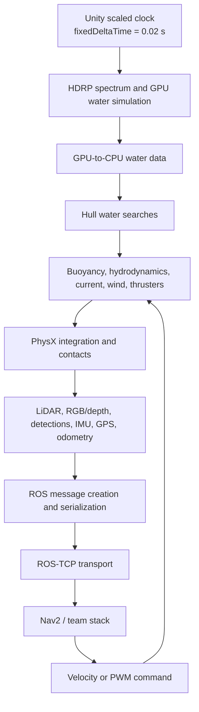

# mhseals_sim architecture and design

This document describes how mhseals_sim is put together: its subsystems, timing model, design
rules and known limitations. Flags, topics and launch commands are in
[SimulationPhysicsAndRuntimeModes.md](SimulationPhysicsAndRuntimeModes.md); measured performance
is in [PerformanceEngineering.md](PerformanceEngineering.md).

## Purpose and scope

mhseals_sim is a Unity 6 simulator for the MHSeals RoboBoat surface vessel. Unity owns the world,
water, physical interaction and sensor generation. ROS 2 owns the navigation stack: localization,
planning, control. The simulator publishes sensors and ground truth over the ROS-TCP Connector and
accepts either desired body velocities (`TwistStamped`) or the boat's own ESC pulse widths
(`/thrusters/pwm`). With `--crane-roboboat-contract` it also publishes the topics the boat's
flight controller would provide, so the team's localization runs unchanged.

HDRP water is part of the physical model: hull components query its displaced surface for
buoyancy and hydrodynamics. Removing it would change the physics, not just the visuals. The only
built scene is `Roboboat Course`.

## Capability summary

| Capability | Status |
|---|---|
| Boat plant on HDRP water (buoyancy, surge/sway/yaw maneuvering model, thruster model) | Implemented; parameters are priors until characterized |
| Graphics-free (`-nographics`) execution of the boat scene | Not possible: HDRP water queries need a graphics device |
| RGB, GPU depth, camera info, 3D LiDAR, 2D LiDAR, semantic detections | Implemented; bounded asynchronous camera readback |
| Render-independent geometric depth | Implemented; sees colliders only |
| ROS-TCP sensors, `/clock`, odometry and TF | Implemented; validated against ROS 2 Jazzy |
| Velocity and PWM command inputs with fixed-step application | Implemented |
| Nav2 `NavigateToPose` loop on ground-truth odometry | Implemented and exercised by `run_nav2_controller_fixture.sh` |
| Localization/SLAM in the loop, Nav2 lockstep | Not validated / absent |
| Scene-reload reset with a live Nav2 graph | Validated |
| In-place reset | Experimental and incomplete |
| Multiple player processes | Supported with per-process ports and ROS domains |
| Explicit/manual physics stepping | Absent by design (see below) |

## Technology stack

Treat the versions resolved by the checkout as authoritative:

| Component | Version or implementation |
|---|---|
| Unity Editor | `6000.5.10f1` |
| HDRP | `17.5.0` |
| Input System | `1.20.0` |
| AI Inference | `2.6.1` |
| Memory Profiler | `1.1.12` |
| ROS integration | Embedded ROS-TCP Connector `0.7.0-preview` with lifecycle patches, plus an external `ros_tcp_endpoint` |
| Robot import | Unity URDF Importer `v0.5.2` |
| Physics | Unity PhysX through Rigidbody and ArticulationBody |

The package manifest and lock file take precedence over older metadata. Package changes,
especially HDRP changes, can alter both performance and the physical water field and must be
re-benchmarked.

## Repository organization

| Area | Main responsibilities |
|---|---|
| `Assets/Scripts/Physics` | Water statics/dynamics, the boat plant (`Physics/Water/Boat`), wind, robot selection and URDF placement |
| `Assets/Scripts/Actuators/Motors` | Motors, thrusters, the ESC-to-thrust `ThrusterModel` |
| `Assets/Scripts/Controllers` | `OmniXController` mixer, ROS command inputs, navigation state, sensor contract, course builder, docking evaluator |
| `Assets/Scripts/Sensors/Lidar` | 2D scans and 3D point clouds |
| `Assets/Scripts/Sensors/Nav` | GPS, IMU, odometry |
| `Assets/Scripts/Sensors/Vision` | RGB, depth, geometric depth, camera info, 3D bounding boxes |
| `Assets/Scripts/Course` | Procedural course generation and ground truth ([Course.md](Course.md)) |
| `Assets/Scripts/Utils` | Body adapters, forces, PID, ROS helpers, action gate, reset, viewer camera, overlays |
| `Assets/Scripts/Performance` | Runtime options, simulation profiles, benchmark runner, trajectory recorder |
| `Assets/Config` | Boat profiles, course family, robot catalog, viewer and simulation-profile assets |
| `Assets/Editor` | Player build (`CranePerformanceBuild`) and editor utilities |
| `Tools/Performance` | Player, Nav2 and response-test launchers; comparison and summary scripts; Nav2 parameter files |
| `Tools/Characterization` | Boat profile priors, survey import and the characterization gate |
| `Tools/RoboBoat` | Course CLI, constraints, truth tools |
| `Tools/Urdf` | URDF regeneration |

Vehicle behavior is assembled in scenes and prefabs by attaching components. This is familiar to
Unity developers, but it spreads behavior across lifecycle callbacks, which is the main obstacle
to a centrally controlled simulation step.

## Runtime dependency model

This is a dependency model. Unity determines the exact callback order through its normal frame
and fixed-update lifecycle; the simulator does not expose the whole chain as one transaction.
That matters when interpreting timestamps or considering manual stepping.

### Simulation time and stepping

The physics step is 0.02 simulated seconds. Raising `Time.timeScale` makes Unity run fixed steps
faster in wall time without changing the step size. Sensor period accumulators use simulated
time and keep fractional remainders, so rates such as 15 Hz do not drift.

Motors, water forces, sensor schedules, publishers and benchmark tick tracking all rely on
`FixedUpdate()`. Switching to `Physics.simulationMode = SimulationMode.Script` and calling
`Physics.Simulate()` would step PhysX but skip or double-run those systems. A manual scheduler
would need explicit exactly-once step interfaces for every system first; it is not a one-line
switch.

### Physics and vehicle abstraction

`IPhysicsBody` presents the force, torque, pose, velocity, inertia and centre-of-mass operations
vehicle code needs; `RigidbodyAdapter` and `ArticulationBodyAdapter` implement it. Motor behavior
derives from `MotorBase<TConfig>`; `Thruster` adds thrust and rotor visuals. Controllers such as
`OmniXController` map a higher-level command to the actuator layout.

The default boat physics is one `MarineSurfacePlant` per hull, configured by `RoboBoatPhysics`
from a boat profile. It combines buoyancy from the clipped hull, a planar maneuvering model with
added mass and relative-water damping (`MarinePlanarModel`), heave/roll/pitch damping and one
`ThrusterActuator` per thruster. The model's math is plain C# with no Unity dependency so that
EditMode tests and the Python twin in `Tools/Characterization/plant.py` can pin it.

The older per-face components (`GeneralDynamics`, `Current`, `FossenDynamics`, voxelized and
simple drag) remain in the project. The plant disables `GeneralDynamics`, `Current` and
`FossenDynamics` on the boat at runtime; `--crane-roboboat-legacy-physics` keeps them. Combining
force components carelessly can apply the same physical effect twice.

When the legacy `Current` component runs, it queries every submerged face if HDRP large- or
ripple-current maps are enabled. When both are disabled, HDRP returns a position-invariant
direction, so the component queries once per hull and tick and shares the result.

### HDRP water integration

The water path is a coupled CPU/GPU pipeline:

1. HDRP advances its water spectrum and displacement simulation.
2. GPU water state reaches scripted CPU searches through HDRP's readback path.
3. Hull components search the displaced surface at their sample locations.
4. Buoyancy and hydrodynamics compute forces from the returned surface.
5. The forces are applied before PhysX integrates the vehicle.

Some apparently visual settings are therefore physical. Water simulation resolution, bands,
update behavior and CPU/GPU simulation mode can change the queried surface. Tessellation,
caustics, reflection quality and spectator rendering are presentation-only, but each change must
still be shown to leave physical queries unchanged.

All three HDRP assets (High Fidelity, Balanced, Performant) run the same 128-resolution GPU water
with readback; `SimProfileTests` fails if a simulation profile's asset drifts. Full-resolution CPU
water raised process CPU from about 6% to 19% on the reference machine and was rejected.

The water needs a graphics device and a real Vulkan render loop. `-nographics` and plain
`-batchmode` without a display do not update the water query path. HDRP still needs a rendering
camera to advance water: when RGB and spectator cameras are off (`train-gpu`), the depth sensor
camera keeps water current, and a scene with no enabled sensor camera gets a separately
classified 64×64 zero-culling water-update driver camera (a 1×1 target was rejected because HDRP
created zero-sized render textures).

The production scene disables water deformation and enables HDRP foam. Spectral time plus the
static scene configuration determine the displacement field used by hull queries; foam and wake
history are not reconstructable from that.

### Sensors

`IROSSensor<T>` connects a sensor's message factory to `ROSPublisher`. Navigation sensors and
LiDAR compute data from the physical world. RGB and GPU depth depend on HDRP rendering and
asynchronous readback; geometric depth depends only on PhysX geometry.

GPU depth keeps the `32FC1`, optical-frame, 1280×720 contract. With ROS transport enabled, each
frame owns its own managed payload because ROS-TCP serializes messages asynchronously; with
transport suppressed, one payload is reused.

`GeometricDepthCamera` caches a pinhole ray table, batches persistent `RaycastCommand`/hit
buffers and Burst-packs top-to-bottom `32FC1` optical-axis Z; near/far misses are quiet NaN. Its
world is PhysX collision geometry only.

The 3D LiDAR keeps persistent native buffers. Command generation, the batched PhysX raycast,
hit classification/compaction and PointCloud2 packing are Burst jobs with batch size 64 on the
production prefab. Exact local-frame conversion stays managed for actual hits, because a fully
Burst conversion differed by about 1.2e-5 m and broke byte equivalence. Debug rays are
presentation-only and off in the `train-*` profiles.

Each observation carries the tick at which it was acquired, even if asynchronous processing
finishes later. RGB and depth use two-request queues; a full queue produces a missed observation
instead of unbounded latency. Results carry an episode generation so callbacks from an earlier
episode are discarded. At high time scales a player can advance many physics steps while GPU
readbacks lag; reporting those images as current would corrupt the relationship between action
and observation, so the timing policy is part of correctness.

### ROS and controller boundary

`ROSPublisher` creates messages on simulated-time schedules and sends them through ROS-TCP unless
transport is suppressed. `ROSSubscriber` registers command callbacks. Clock helpers publish
episode-relative `/clock`.

Simulation time is not a processing barrier: an accelerated player must not keep applying an old
command while the ROS controller is still computing. The velocity, PWM and thruster inputs
therefore enqueue immutable action receipts instead of mutating motors from transport callbacks.
A single-slot latest-value mailbox crosses `CraneActionGate` in `FixedUpdate`, where episode,
source, sequence, receive tick, application tick, duplicate ordering and an optional maximum lag
are checked before any actuator changes. `--crane-action-policy latest` accepts the newest valid
command; `--crane-action-policy bounded --crane-max-action-lag-ticks N` also rejects commands that
waited too long in the queue.

`TwistStamped` carries a header stamp, which `ROSOmniXCommand` converts to a source-observation
tick. Plain Nav2 `Twist` has no stamp; the Nav2 launcher's fixture node stamps it with the newest
odometry it has received. That bounds delivery age but cannot show which sample Nav2 used
internally. The PWM input (`UInt16MultiArray`) has no source stamp, so its lag check falls back to
receive-to-application age.

Benchmark results aggregate accepted-action timing per episode: known-source count, mean/maximum
source-to-application and receive-to-application ticks, maximum gap between applications, and
watchdog stops. The Nav2 launcher's summary fails if any applied command lacks a stamp or a lag
maximum exceeds the configured bound.

An ArduPilot JSON UDP bridge also exists under the legacy class name `MAVROSConnection` (it is not
a MAVROS node). The RoboBoat path does not use it; the PWM input requires `--crane-disable-sitl`.
Its JSON telemetry is not in ArduPilot's frames (z-up position instead of NED, world-frame gyro,
raw Unity Euler angles, constant acceleration); fix that before connecting a real ArduPilot SITL.

When ROS processes are split across Docker containers, all Fast DDS containers must share an IPC
namespace (`--ipc host`); otherwise discovery can show topics while shared-memory payloads fail.
Direct connector `/tf` works once the data plane is shared; no TF relay is needed.

Measured ROS-TCP load at 1×: 1280×720 depth at 15 Hz is about 55.3 MB/s of raw payload and the
72,000-point LiDAR at 10 Hz about 8.64 MB/s.

### Episode reset

Scene reload is the reset baseline. On reload, `ROSConnection.OnDestroy` cancels and joins its
socket task before the replacement scene connects, and the endpoint removes the disconnected
client's publishers, subscribers and services. `/clock` rewinds to zero; Nav2 clears its TF buffers
after the backward jump and navigation resumes. Runtime scene selection disables the transient
build-index-zero scene's sensors and transports before they start, so only the requested scene
owns the ROS graph.

`CraneEpisodeResetCoordinator` is an experimental in-place reset. It restores body poses and
velocities, articulation state, sleep state, Unity RNG, episode/tick counters and components that
implement `ICraneEpisodeResettable` (motor/PID state, queued commands, camera readback queues,
publisher and clock phase, HDRP spectral time). It does not reset external ROS/controller state,
estimators, costmaps, spawned objects or foam/wake state, so keep using scene reload.

`/crane/reset_to_start` is a separate convenience: it puts the boat back at rest on the course
start pose without reloading the scene.

ROS callbacks are serviced by Unity's normal update loop. Any future manual stepping loop must
yield often enough for the connector to process incoming work.

### Benchmark and multi-process architecture

`CraneBenchmarkRunner` installs before scene load when `--crane-benchmark` is present. It
collects wall and simulated time, real-time factor, profiler markers, process CPU, GPU frame time,
memory, GC allocation, data-quality counters, body and water samples, and sensor signatures, and
writes JSON that marks a run invalid when required observations fail. Stable profiler markers
cover the simulation step, water preparation/query/buoyancy, vehicle dynamics and thrusters,
LiDAR and other sensors, ROS message creation and publishing, and reset.

`run_worker.sh` adds GPU/VRAM sampling. `sweep_workers.sh` gives each player its own seed,
ROS-TCP port, UDP port, output directory and `ROS_DOMAIN_ID`; `sweep_nav2_workers.sh` does the
same for ports and domains and adds one endpoint and Nav2 graph per player. Separate
processes are the scaling model because Unity, HDRP water and several engine systems hold global
state.

## Runtime profiles

Three runtime concepts stay distinct:

1. **Physics**: the world, physical models and sensors the task needs.
2. **Robot visual sensors**: only the RGB, depth or related observations the stack consumes.
3. **Presentation**: spectator cameras, UI, recording, reflections, shadows, post-processing,
   caustics and other human-facing output.

The named `--crane-profile` presets apply these boundaries; the separate simulation profile
(`--crane-sim-profile`) scales rendering and sensor cost to the machine. Neither changes physics.

## Design principles

### Optimize valid experience, not FPS

A speed-up is useful only when trajectories, contacts, water samples, sensor values, timestamps
and command freshness stay within defined tolerances. A player that drops camera frames or reuses
stale commands is less useful even if it reports higher FPS.

### Measure one bounded change at a time

1. State a hypothesis tied to a measured bottleneck.
2. Record a reference with fixed scene, seed, build and runtime arguments.
3. Make the smallest change that tests the hypothesis.
4. Repeat the benchmark and compare at equal simulated timestamps.
5. Keep the change only when its speed and fidelity effects are understood.

### Preserve the physical model by default

Prefer removing duplicate work, reusing storage, batching and avoiding synchronization over
changing timesteps, solver settings, water spectra or sensor resolution. Fidelity reductions must
be named profiles with explicit acceptance criteria.

### Keep simulated time authoritative

Physics, sensor acquisition, ROS timestamps and command application refer to one simulated
timeline. Wall time measures throughput; rendered frames do not define sensor frequency.

### Scope asynchronous work to an episode and tick

Every GPU readback, queued observation and external command carries enough identity to reject
results from a previous episode or obsolete tick. Queue bounds turn GPU or controller backpressure
into a visible invalid-run condition instead of hidden latency.

### Separate physics, robot sensing and presentation

The separation must happen at explicit scene and configuration boundaries, so turning off visual
effects cannot silently change water physics.

### Keep abstractions narrow

Interfaces such as `IPhysicsBody`, `IROSSensor<T>`, motor configurations and controller mappings
let new hardware reuse tested behavior. Add abstractions when they remove demonstrated coupling or
make correctness testable.

## Known limitations

- **Lifecycle coupling.** System order is implicit across `FixedUpdate()`, `Update()`, render
  callbacks and asynchronous completions. There is no common exactly-once step contract, which
  blocks manual stepping and complicates deterministic reset.
- **Visual sensor throughput.** Full-resolution RGB/depth readback is the largest sensor cost. At
  2× on the reference machine each camera completed 173 of 180 scheduled frames over 12 simulated
  seconds, with up to seven ticks of observation age, so full RGB+depth is valid only at 1×.
  Lowering resolution or rate changes the observation model.
- **Per-component water searches.** Hull water queries are issued per component, not batched per
  water surface. Batching could save setup work but must be checked against reference water
  heights and trajectories.
- **Command provenance.** Nav2 `Twist` and PWM commands carry no source-observation stamp.
  Localization/SLAM in the loop, internal Nav2 sample consumption and accelerated lockstep are not
  validated.
- **Reset completeness.** In-place reset is partial (see above); production runs must use scene
  reload.
- **Determinism.** Repeated runs differ by millimetres in trajectory and water height. Acceptance
  uses measured repeatability tolerances rather than bitwise equality; hardware, driver, HDRP or
  package changes need new baselines.
- **Boat parameters.** The default `ideal` profile is priors only; see
  [SimulationPhysicsAndRuntimeModes.md](SimulationPhysicsAndRuntimeModes.md#boat-profiles).

## Optimization opportunities

Lower risk (remove or combine work): batch hull searches per water surface with persistent
buffers; reuse previous search locations as hints with teleport guards; share identical water
samples between buoyancy, drag and sensors in one tick; cache invariant data outside hot loops;
remove remaining hot-loop component lookups and logging.

Medium risk (change execution while preserving the model): overlap LiDAR raycast completion with
other fixed-step work; render sensor cameras only on acquisition ticks while keeping the water
resources physical queries need; multi-rate water updates with interpolation, checked against
wave-height and trajectory tolerances.

High risk or fidelity-sensitive: water resolution/band/sample-density/search-tolerance sweeps;
camera resolution/rate or LiDAR density reductions; timestep, solver, contact or sleep-threshold
changes; a CPU-only water backend; explicit manual stepping; multiple physics scenes per process.

## Adding or changing a subsystem

### Vehicle or actuator

1. Choose Rigidbody or ArticulationBody and use the `IPhysicsBody` adapter path.
2. Add only the force models you need; check that overlapping components do not apply a force
   twice. For the RoboBoat, change the boat profile rather than adding components.
3. Express actuator limits, direction, saturation and dynamics in configuration.
4. Keep visual propeller animation separate from physical thrust.
5. Add reference trajectories for zero input, constant input, saturation and combined motion.

### Sensor

1. Define the physical acquisition time and the output frame convention.
2. Schedule from simulated time and keep the fractional period remainder.
3. Reuse buffers and bound asynchronous work.
4. Attach episode generation and acquisition tick to deferred results.
5. Implement the ROS message through `IROSSensor<T>` and `ROSPublisher`.
6. Validate values, misses, transforms, timestamps, message layout and delivery rate in static and
   moving scenes.

### Controller or ROS command path

1. Keep command interpretation separate from actuator physics.
2. Record the source observation tick on the command where the message allows it.
3. Apply commands only in `FixedUpdate` through `CraneActionGate`.
4. Reject or account for stale, future, duplicated or cross-episode commands.
5. Test scripted commands, a trivial ROS controller and the full Nav2 stack separately.

### Environment or water settings

1. Record the HDRP asset, water settings, scene, seed and graphics backend.
2. Capture reference water samples and vehicle trajectories before changing quality settings.
3. Classify each setting as physical water, robot sensor or presentation.
4. Compare at equal simulated timestamps.

## Reproducibility checklist

A benchmark or test run should record:

- Unity and resolved package versions
- scene, course, seed, player ID and episode ID
- fixed timestep, time scale, physics settings, HDRP asset, boat profile (name and hash) and
  sensor configuration
- ROS domain and all TCP/UDP endpoints
- simulation, observation, command-source and command-application ticks
- queue ages, missed/stale/failed observations and logged errors
- real-time factor, marker totals, CPU/GPU utilization, memory, allocations and reset time
- body trajectories, water samples and sensor signatures

Compare candidates at equal simulated time with identical seeds and configurations, establish the
reference's own run-to-run variation before setting tolerances, and exclude invalid runs rather
than letting an average hide them. An acquisition timestamp says when the world was observed; a
completion timestamp measures processing delay. They are not interchangeable.

## Glossary

| Term | Meaning |
|---|---|
| RTF | Real-time factor: simulated seconds per wall-clock second |
| Valid throughput | Simulated time per wall second that passes physics, sensor, timing and queue checks |
| Acquisition tick | Simulation tick at which a sensor sampled the world |
| Application tick | Simulation tick at which a command affected the vehicle |
| Episode generation | Monotonic ID used to reject asynchronous results from an earlier episode |
| Plant | The boat's physical model: mass, added mass, damping, buoyancy and thrusters |
| Presentation | Human-facing cameras, UI, effects and recording |
