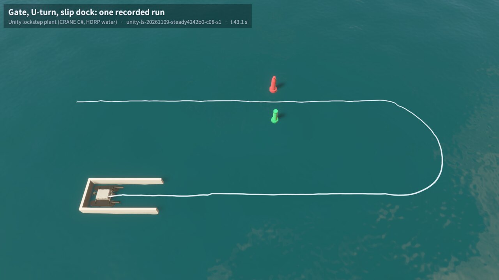
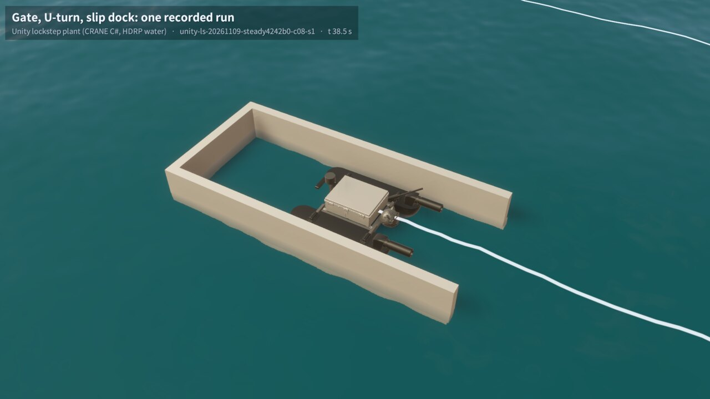

# mhseals_sim

The MHSeals RoboBoat simulator: a Unity (HDRP) simulation of our boat on RoboBoat courses, talking
to the ROS 2 autonomy stack over ROS-TCP. Water, buoyancy, thrusters, cameras, depth, LiDAR,
GPS and IMU run in Unity. Planning, navigation and control run in ROS 2 (Nav2, `mhseals_nav`).

<table>
  <tr>
    <td width="50%"><br><sub>Gate, U-turn and slip dock, replayed with HDRP water.</sub></td>
    <td width="50%"><br><sub>Final approach into the docking slip.</sub></td>
  </tr>
</table>

## Install (one line)

**Linux** (Ubuntu/Debian, Fedora/RHEL, Arch, openSUSE; other distros use user-level fallbacks):

```bash
curl -fsSL https://raw.githubusercontent.com/MHSeals/mhseals_sim/main/install/install.sh | bash
```

**Windows** (PowerShell):

```powershell
irm https://raw.githubusercontent.com/MHSeals/mhseals_sim/main/install/install.ps1 | iex
```

This installs git, git-lfs, Unity Hub and Unity **6000.5.10f1**, checks Vulkan (Linux), and clones
this repo to `~/mhseals_sim`. Running it again updates the clone in place. Options (another
folder, extra build modules, dry run) are listed in [install/README.md](install/README.md).

One step can't be scripted: **open Unity Hub, sign in, and activate a free Personal licence**
(Hub → Preferences → Licenses).

<details><summary>Manual install</summary>

1. Install [Unity Hub](https://docs.unity3d.com/hub/manual/InstallHub.html), git and
   [git-lfs](https://git-lfs.com).
2. `git lfs install && git clone https://github.com/MHSeals/mhseals_sim.git`
3. In Unity Hub: **Add → Add project from disk**, pick the folder, and install the editor
   version it asks for (6000.5.10f1).
4. Linux only: make sure Vulkan works (`vulkaninfo --summary`). The project renders with Vulkan.

</details>

## Run it

1. Open the project in Unity, then **MHSeals → Open RoboBoat Course** (or open
   `Assets/Scenes/Roboboat Course.unity`).
2. Press **Play**. The boat floats in the course and you can drive it from the keyboard.
3. To connect ROS 2, start the endpoint on the ROS machine or container:

   ```bash
   ros2 run ros_tcp_endpoint default_server_endpoint --ros-args -p ROS_IP:=0.0.0.0 -p ROS_TCP_PORT:=10000
   ```

   If ROS isn't on the same machine, set the address in the scene's `ROSConnection` object (or
   **Robotics → ROS Settings**). In our workspace the endpoint comes with
   [astro_dock](https://github.com/1unarzDev/astro_dock) (`src/ros_tcp_endpoint`).

### Controls

| Input | Action |
|---|---|
| `W` `A` `S` `D`, `Q` `E` (and `Space`/`Shift`, `Z`/`X`) | Drive the boat by hand. A key press overrides ROS commands while held. Bindings: `Assets/Config/FullOmniControlConfig.inputactions` |
| `1` … `8` | Camera presets: Chase, Side, Front, Corner, Overhead, Map, Task, Course |
| `V` | Next camera preset |
| Right mouse drag, scroll wheel | Orbit, zoom |

### Main ROS interfaces

| Topic | Direction | What |
|---|---|---|
| `camera/image_raw`, `camera/depth`, `camera/camera_info` | sim → ROS | RGB and depth camera |
| `points`, `scan` | sim → ROS | LiDAR (VLP-16 style point cloud, 2D scan) |
| `gps/raw`, `imu/raw` | sim → ROS | GPS and IMU at their URDF mount points |
| `/detections` | sim → ROS | Ground-truth object detections (buoys, docks) with partial-visibility modelling |
| `/crane/odom`, `/tf` | sim → ROS | Ground-truth odometry and TF (50 Hz) |
| `/thrusters/pwm` | ROS → sim | Per-thruster ESC pulse commands (the real boat's interface) |
| `/crane/cmd_vel_stamped` | ROS → sim | Stamped velocity command; stale commands are dropped |
| `/crane/reset_to_start` | ROS → sim | Put the boat back at the course start pose (sim only) |
| `/crane/truth/course`, `/crane/truth/states` | sim → ROS | Course layout and object states, for scoring and debugging |

The `crane` prefix is the engine's internal name. It stays the same so updates from upstream
apply cleanly.

## Pick a performance profile

The sim measures your machine on first launch and picks a tier. Each tier changes rendering and
sensor rates only, never physics:

| Tier | For |
|---|---|
| `full` | Desktop GPU, full camera resolution and effects |
| `balanced` | Gaming laptops |
| `minimal` | Integrated graphics or older laptops. Smaller camera images, effects off |

Force one with `--crane-sim-profile minimal` on a built player. The active profile is published
on `/crane/sim/profile`. Details: [Docs/PerformanceEngineering.md](Docs/PerformanceEngineering.md).

## Courses

RoboBoat 2025 and 2026 courses are generated from specs in `Tools/RoboBoat/courses` (entry gates,
navigation channel, debris clearance, docking and others). To make or check a course:

```bash
Tools/RoboBoat/generate.sh --family roboboat_2026 --seed 7 --out course.json   # headless, uses the editor
python3 Tools/RoboBoat/validate.py course.json                                 # check it against the spec
```

`Tools/RoboBoat/cli` (coursegen, .NET 10) writes the same files without opening the editor. It still needs the Unity install for `UnityEngine.CoreModule.dll`.

See [Docs/Course.md](Docs/Course.md).

## Build and run a player

**MHSeals → Build → Linux Player / Windows Player** builds to `Builds/CRANE-Worker/` or
`Builds/CRANE-Worker-Windows/`. Cross-building needs the other platform's *Build Support (Mono)*
module from Unity Hub. From a terminal:

```bash
Unity -batchmode -quit -projectPath . -executeMethod CranePerformanceBuild.BuildLinuxWorker
./Builds/CRANE-Worker/CRANE.x86_64 --crane-sim-profile balanced        # windowed
./Builds/CRANE-Worker/CRANE.x86_64 -batchmode --crane-sim-profile minimal  # headless, no window
```

`--crane-list-profiles` prints the runtime profiles. All `--crane-*` flags are described in
[Docs/SimulationPhysicsAndRuntimeModes.md](Docs/SimulationPhysicsAndRuntimeModes.md).

## Nav2 in the loop

`Tools/Performance/run_nav2_controller_fixture.sh` runs a full Nav2 `NavigateToPose` loop
against a player: costmaps from the sim LiDAR, NavFn planning, the RoboBoat controller profile
(`nav2_controller_fixture.yaml`) and the behaviour tree. It needs a built astro_dock workspace
(`CRANE_ASTRO_DOCK`, default `../astro_dock`) and a ROS 2 Jazzy image with Nav2
(`CRANE_ROS_IMAGE`, default `lunarzdev/astro:cuda`). What the baseline covers, and its limits:
[Docs/RoboBoatNavigationBaseline.md](Docs/RoboBoatNavigationBaseline.md).

## Repository map

| Path | What |
|---|---|
| `Assets/Scenes/Roboboat Course.unity` | The course scene |
| `Assets/Robot Descriptions/blastoise` | Our boat: URDF, meshes, prefab |
| `Assets/Scripts/Physics/Water` | Buoyancy, hull drag, marine plant model, wind and current |
| `Assets/Scripts/Actuators`, `Controllers` | Thrusters (ESC pulse model), mixers, ROS command inputs |
| `Assets/Scripts/Sensors` | Cameras, depth, LiDAR, GPS, IMU, detections |
| `Assets/Scripts/Course` | Course generation from specs |
| `Assets/Scripts/Performance` | Runtime flags, performance profiles, trajectory recording |
| `Tools/RoboBoat` | Course specs, generator and validator (Python) |
| `Tools/Characterization` | Boat physics profiles and the Python twin of the plant |
| `Tools/Performance` | Nav2 launchers, configs and plotting |
| `install/` | The one-line installers |
| `Docs/` | [Documentation index](Docs/README.md) |

## Tests

- Unity: **Window → General → Test Runner → EditMode → Run All**, or
  `Unity -batchmode -projectPath . -runTests -testPlatform EditMode -testResults results.xml`
- Python: `python3 -m pytest -p no:cacheprovider Tools/RoboBoat/tests Tools/Characterization Tools/Performance`
  (CI runs these on every push)

## Troubleshooting

- **Pink or black scene on Linux:** Vulkan isn't working. Check `vulkaninfo --summary` and your
  GPU driver. Vulkan must be the Linux graphics API (Project Settings → Player).
- **"No valid Unity Editor license":** sign in to Unity Hub and add a Personal licence.
- **Models look like text files or are missing:** run `git lfs install && git lfs pull`.
- **ROS can't see topics:** check the endpoint is running on port 10000 and the `ROSConnection`
  address. On Windows, allow Unity through the firewall.
- **Slow on a laptop:** start with `--crane-sim-profile minimal`.

## Contributing

Open an issue or a PR. Keep changes RoboBoat-focused. The simulation engine is shared with the
upstream CRANE project, so engine fixes should keep its `Crane*` names.

## License

GPL-3.0. See [LICENSE](LICENSE) and [THIRD_PARTY_NOTICES.md](THIRD_PARTY_NOTICES.md).
